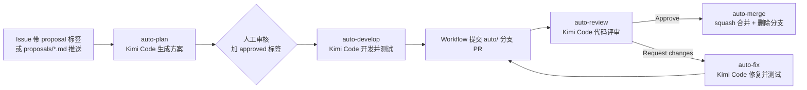

# IPQC — GitHub Actions + Kimi Code 自动开发流水线

本仓库内置一条“方案 → 开发 → 评审 → 合并”的 AI 自动开发流水线。GitHub Actions 负责事件、权限和确定性操作，Kimi Code CLI 负责方案生成、代码开发、测试修复和代码评审。



## 快速开始

### 1. 配置凭据与模型

1. 在 [Kimi Code 控制台](https://www.kimi.com/code/docs/en/)创建 API Key；
2. 打开仓库 **Settings → Secrets and variables → Actions**，新建 Repository secret：
   - `LLM_API_KEY`：Kimi Code API Key（**必需**）；
3. 可选：在同页 **Variables** 中配置：

| Variable | 默认值 | 说明 |
| --- | --- | --- |
| `LLM_BASE_URL` | `https://api.kimi.com/coding/v1` | 海外可改为 `https://api.kimi.ai/coding/v1` |
| `LLM_MODEL` | `kimi-for-coding` | 使用的模型，可换成会员支持的其他模型 |
| `KIMI_CLI_VERSION` | `latest` | 安装的 CLI 版本；稳定使用建议固定版本号 |

Workflow 会通过仓库内复合 Action 安装 Node.js 22 和 `@moonshot-ai/kimi-code`，无需自行维护 runner。

### 2. 使用流程

| 步骤 | 动作 | 结果 |
| --- | --- | --- |
| ① 提需求 | 新建 Issue 并加 `proposal` 标签，或推送 `proposals/xxx.md` | 自动方案以评论发布到 Issue，并加 `plan-ready` 标签 |
| ② 审核方案 | 人工阅读方案评论 | 方案包含技术设计和 3~7 个可验收任务 |
| ③ 启动开发 | 给 Issue 加 `approved` 标签 | Kimi Code 实现全部任务并运行项目验证，Workflow 推送 `auto/issue-<n>` 分支并创建 PR |
| ④ 自动评审 | 无需操作 | 对同源仓库的新 PR 自动提交 Approve 或 Request changes |
| ⑤ 自动合并 | 无需操作（评审通过时） | 等待检查通过后 squash 合并并删除开发分支，关联 Issue 自动关闭 |
| ④' 被打回 | 无需操作 | 自动修复并重新进入评审，最多 3 轮，之后转人工 |

> 同源仓库的人工 PR 也会被自动评审，但不会被自动合并。fork PR 不运行带模型凭据的自动评审。

## 实现方式与自定义

- **智能任务**：`.github/prompts/` 下的五个 Prompt 分别控制 Issue 方案、文档方案、开发、评审和修复，可直接按项目约定调整。
- **确定性操作**：`.github/workflows/` 负责触发条件、分支复用、空变更检测、保护目录检查、提交、PR、评审发布和合并。各阶段通过 `workflow_dispatch` 显式调度下一阶段，避免 `GITHUB_TOKEN` 的二次事件抑制。
- **CLI 安装**：`.github/actions/setup-kimi/action.yml` 统一安装和校验 Kimi Code CLI。
- **项目测试**：Agent 自动识别并运行项目已有的测试、构建或静态检查；失败时修复并重跑。

## 安全与边界

- `kimi -p` 非交互模式会自动执行常规工具，因此只向 Workflow 提供完成任务必需的权限和凭据；
- Prompt 禁止修改 `.github/`，Workflow 在提交前再次通过 Git diff 强制检查，命中即失败且不推送；
- 没有文件变更时不创建空提交或 PR；
- 自动合并仅接受 `auto/` 分支和 `github-actions[bot]` 对当前 head SHA 的 Approved 评审；合并 API 会再次原子校验 SHA，防止旧评审合入新提交；
- fork PR 不运行自动评审，避免向不受信任代码暴露模型 Secret；
- 建议为 `main` 配置分支保护规则，与自动合并前的检查等待步骤配合。

## 目录结构

```text
.github/
  actions/setup-kimi/
    action.yml              # Node.js 22 + Kimi Code CLI 安装
  prompts/
    plan-issue.md           # Issue → 开发方案
    plan-doc.md             # 方案文档 → Issue + 开发方案
    develop.md              # 方案 → 代码 + 测试
    review.md               # PR diff → 结构化评审
    fix.md                  # 评审意见 → 修复 + 测试
  workflows/
    auto-plan.yml           # ① 生成方案
    auto-develop.yml        # ③ 自动开发 + 提 PR
    auto-review.yml         # ④ 自动评审
    auto-fix.yml            # ④' 评审打回自动修复
    auto-merge.yml          # ⑤ 自动合并 + 删分支
docs/superpowers/specs/     # 设计文档
docs/superpowers/plans/     # 实施计划
proposals/                  # 方案文档目录（推送即触发方案生成）
```

## 故障排查

- 工作流失败：在 Actions 页面查看对应运行日志；
- 提示 API Key 为空：检查仓库 Secret 是否名为 `LLM_API_KEY`；
- LLM 报 401/429：检查 Key、会员额度、模型权限和 Base URL；
- CLI 行为异常：固定 `KIMI_CLI_VERSION`，排除最新版本变更影响；
- 想重新生成方案：删除 Issue 中机器人发布的方案评论后，去掉再重新添加 `proposal` 标签；
- 自动修复已转人工：处理最新评审意见后推送，或人工调整 PR。

## 设计文档

详见 [自动开发流水线设计](docs/superpowers/specs/2026-11-05-auto-dev-pipeline-design.md)和 [Kimi Code CLI 重构实施计划](docs/superpowers/plans/2026-11-05-kimi-cli-pipeline.md)。
