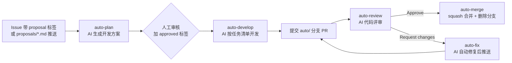

# IPQC — 基于 GitHub Actions 的自动开发流水线

本仓库内置一条"方案 → 开发 → 评审 → 合并"的 AI 自动开发流水线，全部逻辑以代码形式存放在 `.github/` 下。



## 快速开始

### 1. 配置 LLM 凭据

流水线通过 OpenAI 兼容接口调用 Kimi Code API（也兼容任意 OpenAI 兼容端点）：

1. 在 [Kimi Code 控制台](https://www.kimi.com/code/docs/en/)创建 API Key（会员可创建最多 5 个）；
2. 打开仓库 **Settings → Secrets and variables → Actions**，新建 Repository secrets：
   - `LLM_API_KEY`：上一步创建的 Key（**必需**）；
3. 可选：同页 **Variables** 中新建（不填则用默认值）：
   - `LLM_BASE_URL`：默认 `https://api.kimi.com/coding/v1`（海外用户用 `https://api.kimi.ai/coding/v1`）；
   - `LLM_MODEL`：默认 `kimi-for-coding`（可换 `k3`、`k3-256k`、`k3.1-pro` 等，见[模型列表](https://www.kimi.com/code/docs/en/)）。

### 2. 使用流程

| 步骤 | 动作 | 结果 |
| --- | --- | --- |
| ① 提需求 | 新建 Issue 并加 `proposal` 标签，或推送 `proposals/xxx.md` | `auto-plan` 生成方案并以评论发布到 Issue，加 `plan-ready` 标签 |
| ② 审核方案 | 人工阅读方案评论 | — |
| ③ 启动开发 | 给 Issue 加 `approved` 标签 | `auto-develop` 按任务清单实现代码，推送 `auto/issue-<n>-<slug>` 分支并创建 PR |
| ④ 自动评审 | 无需操作 | `auto-review` 对 PR 提交 AI 评审（Approve / Request changes） |
| ⑤ 自动合并 | 无需操作（评审通过时） | `auto-merge` 等待检查通过后 squash 合并，并删除开发分支，关联 Issue 自动关闭 |
| ④' 被打回 | 无需操作 | `auto-fix` 按评审意见自动修复并推送，重新进入评审（最多 3 轮，超限转人工） |

> 人工提交的 PR 同样会被自动评审，但**不会被自动合并**（仅 `auto/` 前缀分支的 PR 会自动合并）。

## 配置参考（`.github/auto-dev.json`）

| 字段 | 默认值 | 说明 |
| --- | --- | --- |
| `labels.proposal` | `proposal` | 标记需求/方案的 Issue 标签 |
| `labels.planReady` | `plan-ready` | 方案已生成标签 |
| `labels.approved` | `approved` | 人工审核通过、允许开发 |
| `branchPrefix` | `auto/` | 自动开发分支前缀（自动合并只作用于该前缀） |
| `defaultModel` | `kimi-for-coding` | 默认模型（可用 Variables `LLM_MODEL` 覆盖） |
| `testCommand` | `""` | 开发后自动执行的验证命令（如 `pytest`、`npm test`），失败时 AI 自动修复 |
| `maxDevRounds` | `60` | 单次开发 agent 最大工具调用轮数 |
| `maxFixRounds` | `2` | 测试命令失败时的最大自动修复轮数 |
| `maxReviewRounds` | `3` | 评审打回后的最大自动修复轮数，超限转人工 |
| `protectedPaths` | `[".github/workflows", ".github/scripts"]` | AI 禁止修改的路径（流水线自保护） |

## 安全与边界

- AI 文件工具只能在仓库内读写，且拒绝写入 `protectedPaths`；
- 自动合并的触发条件：`auto/` 分支 + 评审者是 `github-actions[bot]` + 状态为 Approved；
- 建议为 `main` 配置分支保护规则（如必需通过检查），与 `auto-merge` 的检查等待步骤配合；
- 流水线只使用标准库 Python 脚本，无第三方依赖，便于审计。

## 目录结构

```
.github/
  auto-dev.json           # 流水线配置
  workflows/              # 5 个自动化 workflow
    auto-plan.yml         # ① 生成方案
    auto-develop.yml      # ③ 自动开发 + 提 PR
    auto-review.yml       # ④ 自动评审
    auto-fix.yml          # ④' 评审打回自动修复
    auto-merge.yml        # ⑤ 自动合并 + 删分支
  scripts/                # Python 标准库实现，无第三方依赖
    ai.py                 # LLM 客户端 + 受限文件工具 + agent 循环
    generate_plan.py
    develop.py
    review_pr.py
    fix_pr.py
docs/superpowers/specs/   # 设计文档
proposals/                # 方案文档目录（推送即触发方案生成）
```

## 故障排查

- 工作流失败：在 Actions 页面查看对应运行日志；
- LLM 报 401：检查 `LLM_API_KEY` 是否正确、会员额度是否充足；
- LLM 报 429/5xx：脚本内置重试，持续失败请降低触发频率或换用高速模型；
- 想重新生成方案：删除 Issue 中机器人发布的方案评论后重新触发（去掉再加 `proposal` 标签）。

## 设计文档

详见 [docs/superpowers/specs/2026-11-05-auto-dev-pipeline-design.md](docs/superpowers/specs/2026-11-05-auto-dev-pipeline-design.md)。
